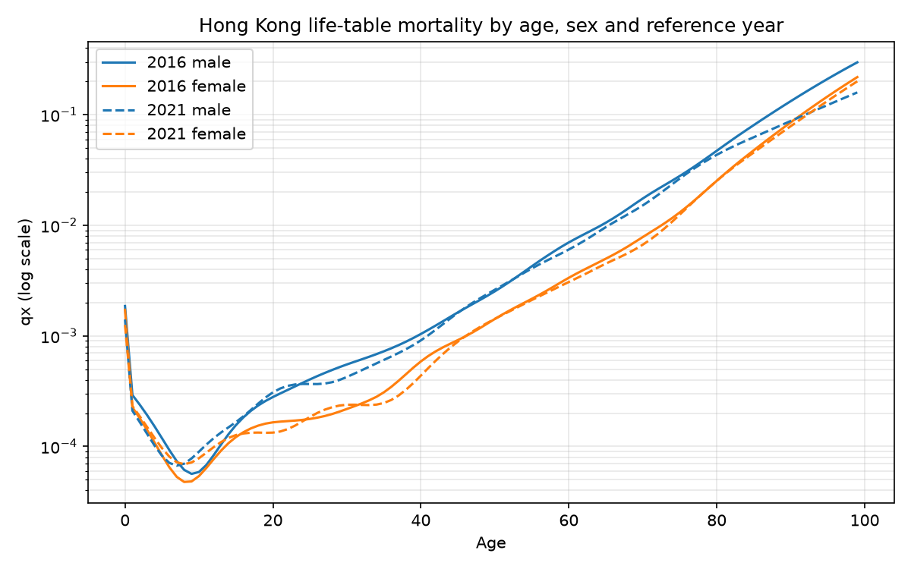
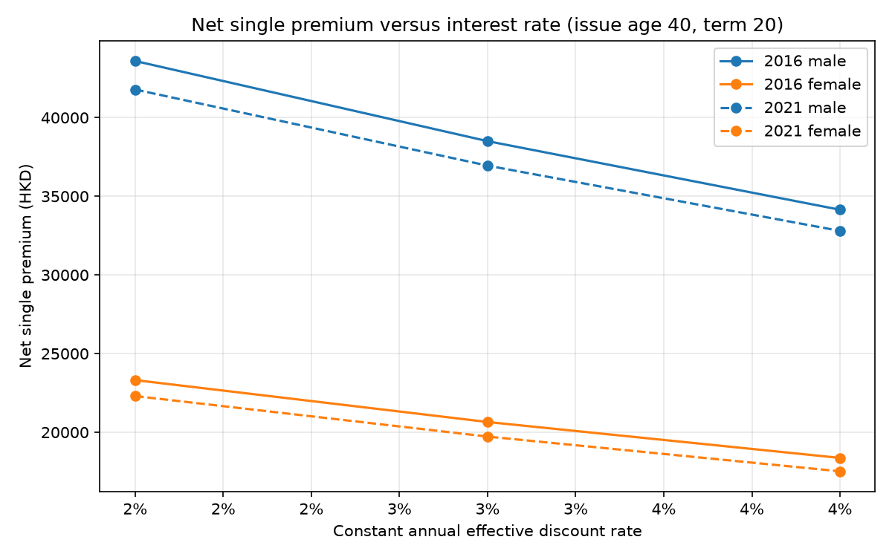
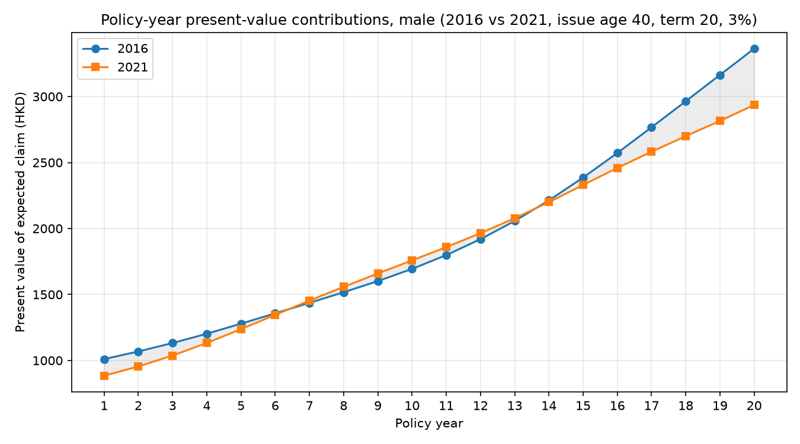

# Hong Kong Mortality and Term-Life Pricing

A small, reproducible actuarial portfolio project that answers one business
question:

> **How does changing the historical mortality basis affect the calculated
> cost of the same term-life insurance benefit?**

The project turns official Hong Kong life tables into a tidy dataset, prices a
fixed term-life contract under a transparent net-single-premium model, and
quantifies how the 2016 → 2021 change in the mortality basis moves the premium.
It is deliberately **not** an enterprise application: no dashboard, no
commercial quote.

## Scope

| Piece | What it does |
|---|---|
| Data pipeline | Extract the 2016 and 2021 male/female life tables from the official C&SD workbook into a tidy CSV. |
| Pricing engine | Price a 20-year term policy issued at age 40 under a fixed mortality schedule. |
| Validation & analysis | pytest tests plus a 2016-vs-2021 comparison, interest sensitivity, and a 10% mortality stress. |
| Notebook | `notebooks/analysis.ipynb` imports the modules above (no duplicated pricing logic) and reproduces every result. |

## Official data source

- **Publisher:** Census and Statistics Department (C&SD), Hong Kong SAR Government
- **Product:** *Hong Kong Life Tables 2016–2046*
- **Workbook:** [B1120016092023XXXXB01.xlsx](https://www.censtatd.gov.hk/en/data/stat_report/product/B1120016/att/B1120016092023XXXXB01.xlsx)
- **Methodology:** [B1120016092023XXXXB01.pdf](https://www.censtatd.gov.hk/en/data/stat_report/product/B1120016/att/B1120016092023XXXXB01.pdf)

Four schedules are used, identified by their observed bilingual sheet titles
(never guessed): **2016 male** (*Table 2*), **2016 female** (*Table 3*),
**2021 male** (*Table 12*), **2021 female** (*Table 13*). Each table runs from
age 0 to 99 with a radix `l(0) = 1,000,000`; the workbook's terminal `100+`
row (`qx = 1`) is excluded from the tidy table.

Download provenance (source URLs, retrieval date, selected sheets, and the
workbook SHA-256 checksum) is recorded in
[`data/raw/provenance.json`](data/raw/provenance.json).

## Installation and reproduction

Requires Python ≥ 3.10.

```bash
python -m pip install -r requirements.txt
```

Run the full pipeline from the project root, in order:

```bash
python scripts/run_pipeline.py    # extract + validate -> data/processed/hk_life_tables_tidy.csv
python scripts/run_pricing.py     # price 4 cases -> results/pricing_comparison.csv + audit CSVs
python scripts/run_analysis.py    # 3 analyses + 3 charts -> results/
```

Run the test suite (33 tests):

```bash
pytest
```

Re-execute the analysis notebook:

```bash
jupyter nbconvert --to notebook --execute notebooks/analysis.ipynb --inplace
# or open it interactively:
jupyter notebook notebooks/analysis.ipynb
```

If the workbook cannot be downloaded automatically (the pipeline uses the
committed local copy first), download it manually from the URL above and place
it at `data/raw/hk_life_tables_2016_2046.xlsx`.

## Pricing method, timing and assumptions

The engine computes a **net single premium** — the present value of expected
death claims only — for a policy issued at **exact age 40** with a **20-year
term** and a **HKD 1,000,000** death benefit.

| Assumption | Value |
|---|---|
| Benefit payment | End of the policy year of death; nothing on survival to expiry |
| Discount rate | Constant annual effective **3%** |
| Mortality | Fixed reference-year schedule, varying by attained age (ages 40–59) |
| Lapses, expenses, commission, tax, profit, capital loading | None |

For policy year `k = 1..20` with attained age `a = 39 + k`:

- `death_probability = survival_to_start × qx[a]`
- `discount_factor = (1 + 0.03)^(−k)`
- `pv_claim = benefit × death_probability × discount_factor`
- then `survival_to_start ← survival_to_start × (1 − qx[a])`

The premium is the sum of `pv_claim`. Full floating-point precision is kept
internally; `qx` values are aligned by **age label**, not row position. This is
an actuarial illustration, **not** a commercial insurance quote.

### Net single premium by mortality basis

| Sex    | 2016        | 2021        | Δ (2021 − 2016) | % change |
|--------|-------------|-------------|-----------------|----------|
| male   | 38,503.39   | 36,947.43   | −1,555.96       | −4.04%   |
| female | 20,651.09   | 19,725.23   | −925.86         | −4.48%   |

## Three findings (computed outputs only)

1. **The 2021 mortality basis is cheaper than 2016 for both sexes.** Holding
   everything else constant, the net single premium falls **−4.04%** for males
   and **−4.48%** for females (see
   [`results/pricing_comparison_by_year.csv`](results/pricing_comparison_by_year.csv)).

2. **The improvement is not uniform across ages.** Decomposing the male
   premium difference by policy year shows the 2021 basis has *higher*
   mortality in mid-term years 7–13 (ages 46–52) but much *lower* mortality in
   years 14–20 (ages 53–59). The single largest contribution is **+426.66** in
   policy year 20 (age 59). The signed per-year contributions sum exactly to
   the total difference of **+1,555.96**
   ([`results/pv_contribution_male.csv`](results/pv_contribution_male.csv)).

3. **Discount-rate and mortality stress move the premium as expected.** For
   2021 males, raising the discount rate from 3% to 4% cuts the premium from
   **36,947.43** to **32,799.68** (−11.2%); applying a 10% `qx` stress (capped
   at 1, survival recomputed) raises it to **40,546.97** (+9.7%)
   ([`results/interest_sensitivity.csv`](results/interest_sensitivity.csv),
   [`results/stress_comparison.csv`](results/stress_comparison.csv)).

## Charts







Each chart has a matching CSV under [`results/`](results/):

- [`mortality_curves.csv`](results/mortality_curves.csv)
- [`interest_sensitivity.csv`](results/interest_sensitivity.csv)
- [`pv_contribution_male.csv`](results/pv_contribution_male.csv)

## Limitations

- The published life-table survivor counts (`lx`) are **hypothetical**
  constructs from a model cohort, not actual observed policy exposures.
- **Population mortality differs from insured-life mortality**; these tables
  describe the whole Hong Kong population, not a life-insurance portfolio.
- A **fixed period mortality table does not forecast future improvement**;
  projecting a 2016 or 2021 schedule forward would be an assumption, not data.
- **Net single premiums exclude expenses, profit, commission, tax and other
  commercial pricing considerations**, so the numbers are not quotes.
- The sensitivity scenarios (interest-rate and 10% `qx` stress) are
  **assumptions, not predictions** — and the 10% stress is an arbitrary
  what-if, not a regulatory calibration or confidence interval.

## Possible extensions

- Price annual-premium and limited-pay structures and compare with the single
  premium.
- Introduce a mortality-improvement assumption (e.g. age-period-cohort).
- Replace population tables with an insured-lives experience table when
  available.
- Add expense, lapse and profit loadings to move toward a gross premium.
- Extend the comparison to the full 2016–2046 projection range in the workbook.

## Licensing

- **Code** (package, scripts, tests, notebook): [MIT License](LICENSE).
- **Data** (the C&SD life-table figures): third-party, governed by its own
  reuse terms — see [DATA-LICENCE.md](DATA-LICENCE.md). The code licence does
  **not** cover the data.

## Layout

```
src/hk_mortality/     # package: config, download, extract, validate, provenance, pipeline, pricing, analysis, plots
scripts/              # run_pipeline.py, run_pricing.py, run_analysis.py
notebooks/            # analysis.ipynb (imports the modules, no duplicated logic)
tests/                # pytest (pipeline, pricing, analysis) — 33 tests
data/raw/             # official workbook + provenance.json
data/processed/       # tidy CSV output
results/              # pricing outputs, charts + their underlying CSVs
```
